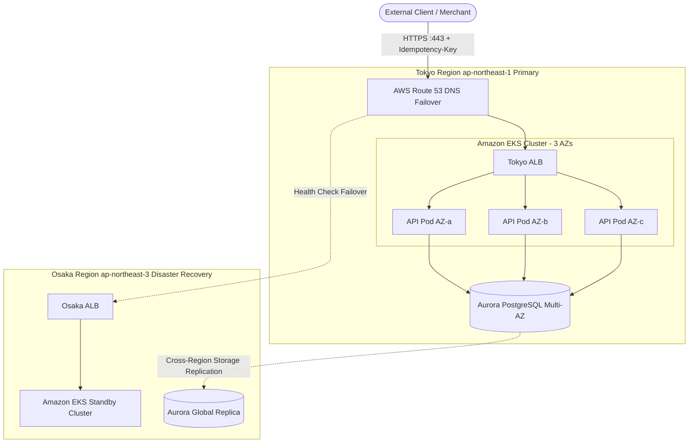

# Kessai (決済) — Zero-Loss Payments on AWS EKS

[](https://github.com/codewithmuh/kessai-payments/releases)
[](https://github.com/codewithmuh/kessai-payments/stargazers)
[](https://github.com/codewithmuh/kessai-payments/network/members)
[](https://github.com/codewithmuh/kessai-payments/actions/workflows/ci.yml)
[](https://github.com/codewithmuh/kessai-payments/actions/workflows/release.yml)
[](LICENSE)
[](https://youtube.com/@codewithmuh)
[](https://www.linkedin.com/in/muhammadrashid-daha/)

**A payments API on Amazon EKS that never loses a payment.** Kessai is a small wallet payments service (top-ups,
payments and refunds in yen, a double-entry ledger, signed webhooks and daily reconciliation). It runs across three
Availability Zones in Tokyo with a disaster-recovery copy in Osaka. Then it gets broken on purpose, in 12 failure
drills that measure how many acknowledged payments were lost (RPO) and how long recovery took (RTO).


---

## 🏛️ Architecture & Disaster Recovery Topology


> **A reference service, not a payment provider.** No real money, no card data. It follows real-world rules
> (idempotency keys, signed webhooks, whole-yen amounts, double-entry bookkeeping) so the failure drills mean
> something.

**Status: phase 0, building in public.** The service plumbing and CI are done; the payments core is next. See the
[roadmap](docs/roadmap.md). Every result in this README will be a measured number, published as each drill runs.

## What it proves

| Question an interviewer asks | How Kessai answers it |
|---|---|
| "What happens when an AZ goes down?" | Drill 4: AWS FIS powers off a Tokyo AZ under load; lost payments are counted |
| "How do you know you lost no data?" | A client outside AWS logs every acknowledged payment and diffs that log against the database |
| "Can a retry charge twice?" | Idempotency keys stored in the same transaction as the payment, tested during a database failover |
| "Do your backups restore?" | Timed restores from a separate, locked backup account, including a ransomware drill |
| "What if the whole region goes?" | An Aurora Global Database failover to Osaka, with lost payments counted and recovered from the snapshot |

The full design, money rules, recovery targets and all 12 drills are in [docs/scope.md](docs/scope.md).

## Quick start

Requirements: [uv](https://docs.astral.sh/uv/), [pre-commit](https://pre-commit.com/) and Docker, or just open
the **Dev Container**.

```bash
make setup    # install dependencies and git hooks
make check    # lint, type-check and test (same as CI)
make up       # PostgreSQL 17, local SQS (ElasticMQ) and the API on :8000

curl localhost:8000/healthz          # {"status": "ok"}
curl localhost:8000/readyz           # {"status": "ready"}
curl localhost:8000/v1/openapi.yaml

make down
```

Run `make` with no arguments to list every command.

## Repository layout

```
services/api/      Django 5.2 LTS service: src/config (settings), src/core (probes, metrics, logs, errors,
                   database outages), tests/, Dockerfile. The payment apps go in src/ as they are built.
dev/               local-only config (ElasticMQ queues)
infra/             Terraform for AWS (phase 0: written and statically checked, not applied)
docs/              scope, roadmap, architecture, threat model, ADRs, runbooks
website/           the landing page and the study guide (learn.html): static HTML, CSS and JS, no build step
compose.yaml       local stack with production-like hardening
Makefile           every command you need
```

## Runtime contract

| Endpoint / behaviour | Meaning |
|---|---|
| `GET /healthz` | Liveness: the process is up (never checks dependencies) |
| `GET /readyz` | Readiness: 503 while shutting down, or after the database has failed for the grace period |
| `GET /metrics` | Prometheus metrics: requests, latency and database outages, by route and status |
| Database outage | `503 database_unavailable` with `Retry-After`; payments are safe to retry with the same `Idempotency-Key` |
| Logs | JSON on stdout, one line per request, with `request_id` |
| `SIGTERM` | Fail readiness, finish in-flight requests (≤ 20 s), exit |
| Image | Non-root user, read-only filesystem, built-in `HEALTHCHECK`, signed with cosign, SBOM on every release |

## How changes flow

1. Open a pull request with a [Conventional Commit](https://www.conventionalcommits.org/) title.
2. CI must pass: lint, types, tests against PostgreSQL, secret and vulnerability scans, image build and smoke test.
3. release-please keeps a Release PR open. Merging it tags the version and publishes a signed image to GHCR with an
   SBOM.

## Production-grade checklist

Every item must pass before v1.0.

- [ ] Code quality: linters, formatters, type checks and pre-commit pass
- [ ] Tests: unit + integration, ≥ 80% coverage, a smoke test and a load test with published numbers
- [ ] CI: every PR runs lint, tests, build and scans; `main` is protected
- [ ] Security: no secrets in git, least privilege, scanned and signed images, SBOM, threat model
- [ ] Infrastructure as code: remote state, `make up` / `make down`, cost estimate, clean teardown
- [ ] Releases: semantic versions, changelog, images in a registry
- [ ] Observability: logs, metrics, traces, dashboards as code, alerts linked to runbooks
- [ ] Reliability: probes, graceful shutdown, timeouts/retries/idempotency, tested backups, written SLOs
- [ ] Docs: README with quick start, architecture, ADRs, runbooks, contributing, license
- [ ] Developer experience: one-command setup, Dev Container or Compose, seed data
- [ ] Demo: screenshots, a short demo video, a write-up

## License

[MIT](LICENSE) © 2026 Muhammad Rashid ([CodeWithMuh](https://youtube.com/@codewithmuh))
