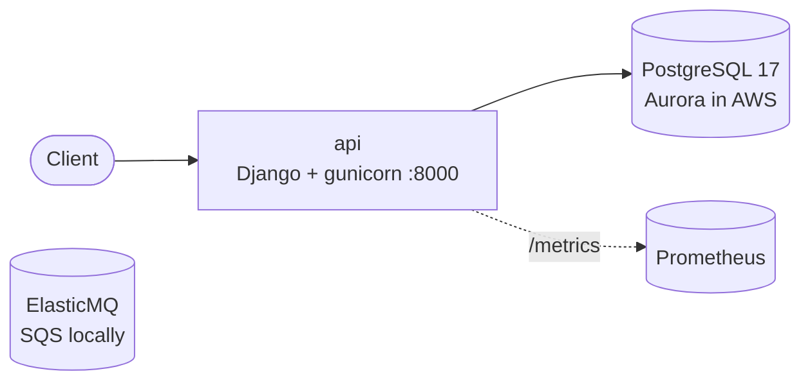

# Architecture

> Keep this page current: update it in the same pull request that changes the architecture.
> The target design is in [scope.md](scope.md). This page describes what is **built** today.

## Context

Kessai is a reference wallet payments API: top-ups, payments and refunds in yen, with a double-entry ledger, signed
webhooks and daily reconciliation. Its purpose is to show, with measured failure drills, that a payments backend on
Amazon EKS loses no acknowledged payment and never charges twice. There is no real money.

## Built so far

| Component | Responsibility | Tech | Status |
|---|---|---|---|
| `api` | HTTP API, runtime contract | Python 3.13, Django 5.2 LTS, DRF, gunicorn | Plumbing done; payment endpoints next |
| PostgreSQL | System of record | PostgreSQL 17 locally, Aurora PostgreSQL in AWS | Local only |
| SQS | Webhook event queue (FIFO + DLQ) | ElasticMQ locally, Amazon SQS in AWS | Queues defined, not used yet |

Planned components are in the [roadmap](roadmap.md): outbox relay, webhook sender, reconciliation job, merchant-sim
and the payment client.

## Runtime contract (every process)

| Concern | How |
|---|---|
| Liveness | `GET /healthz`: the process is up. It never checks dependencies |
| Readiness | `GET /readyz`: 503 while shutting down, or when the database has failed for longer than `READINESS_DB_GRACE_SECONDS` (default 120 s). A shorter outage keeps the pod ready so clients get 503 + `Retry-After` (see `core/database.py`) |
| Database outage | Requests answer `503 database_unavailable` with `Retry-After`; payments are safe to retry with the same `Idempotency-Key` |
| Metrics | `GET /metrics`: `http_requests_total`, `http_request_duration_seconds`, `kessai_database_unavailable_total` |
| Logs | One JSON line per event on stdout, with `request_id` |
| Shutdown | On SIGTERM: fail readiness, drain in-flight requests (≤ 20 s), exit 0 |
| Config | Environment variables only; secrets have no defaults and stop startup if missing |
| Security | Non-root user, read-only filesystem, no capabilities, slim base image |

## Data

Not built yet. The money rules R1–R7 in [scope.md](scope.md#money-rules) decide the schema.

## Deployment

Local: `make up` (Docker Compose). AWS: not deployed yet (phase 1).

## Reliability

SLOs, alerts and runbooks arrive with phase 1. Recovery targets are in [scope.md](scope.md#recovery-targets).

## Security

Trust boundaries and controls: see [threat-model.md](threat-model.md).

## Decisions

See [adr/](adr/).
