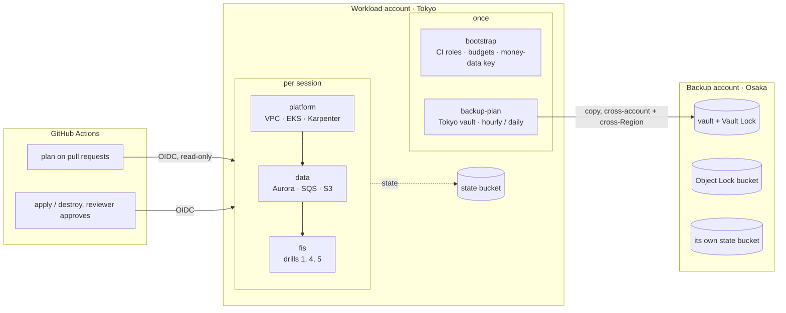

# infra: AWS for Kessai (Terraform)

> **Status: written and statically checked only (2026-10-19).** Nothing has been planned or applied, and no AWS
> account is attached yet. `make check` (fmt, validate, tflint, trivy, checkov) passes. The first apply waits for the
> personal AWS profile.

Six Terraform stacks put Kessai on AWS: the payments platform in Tokyo (ap-northeast-1) and immutable backup copies
in a separate account in Osaka (ap-northeast-3). Terraform owns **AWS resources only**. Everything that runs inside
the cluster, including the Karpenter controller, the AWS Load Balancer Controller, External Secrets and the app, is
installed by Argo CD from git. The per-session stacks are **created and destroyed in one sitting**
(`make aws-up` … `make aws-down`), so they cost money only while you work.

| Stack | Account · Region | Lifecycle | Creates |
|---|---|---|---|
| [bootstrap/](bootstrap/) | workload · Tokyo | once per account | GitHub OIDC provider, CI roles `kessai-github-plan` (read-only) and `kessai-github-apply`, a $100 monthly budget and a $10 daily budget, and the **money-data key** (`alias/kessai-data`, KMS, multi-Region). The S3 state bucket comes from [scripts/create-state-bucket.sh](scripts/create-state-bucket.sh). |
| [platform/](platform/) | workload · Tokyo | per session | VPC over `apne1-az4/az1/az2` (public, private, intra and database subnets, one NAT gateway, S3 gateway endpoint, flow logs), EKS 1.36 with ARC zonal shift and a small Graviton system node group, the AWS side of Karpenter, Pod Identity roles for the EBS CSI driver, AWS Load Balancer Controller and External Secrets |
| [data/](data/) | workload · Tokyo | per session | Aurora PostgreSQL 17.7 (writer + reader in different AZs, RDS-managed password, deletion protection, PITR), the optional Global Database primary, the SQS FIFO webhook queue with its dead-letter queue, the settlement-file bucket, and Pod Identity roles for outbox-relay, webhook-sender, mock-bank and reconcile |
| [fis/](fis/) | workload · Tokyo | per session, after the app | FIS templates for drills 1 (pod delete), 4 (AZ power interruption) and 5 (Aurora failover), their IAM roles, the stop-condition alarm and a log group per session |
| [backup-plan/](backup-plan/) | workload · Tokyo | once | AWS Backup: a Tokyo vault, hourly Aurora and daily EKS backups, each copied to the backup account's Osaka vault |
| [backup-account/](backup-account/) | **backup** · Osaka | once, in the other account | The destination vault with Vault Lock, its KMS key, the access policy that lets only the workload account copy in, and an S3 bucket with Object Lock in compliance mode. Its state lives in a bucket in the backup account. |



## Why six stacks

Tasuki has two (bootstrap and platform). Kessai splits further along two lines, lifecycle and account:

- **Lifecycle.** `bootstrap`, `backup-plan` and `backup-account` hold things that must outlive a session: CI roles,
  budgets, the KMS key that encrypts every snapshot, and vaults that cannot be deleted while they hold recovery points.
  `platform`, `data` and `fis` are created and destroyed every session.
- **Order.** `data` needs the VPC and cluster from `platform`; `fis` needs the load balancer the app creates. Each later
  stack looks the earlier ones up by name (data sources), so a missing dependency fails the plan, not the apply.
- **Deletion protection.** Aurora sits in its own stack so `make aws-down` can lift its deletion protection in a
  visible apply before destroying it, without touching the cluster.
- **Account boundary.** `backup-account` is applied with the backup account's own credentials, and its state lives in
  that account. Nothing in the workload account, not even a Terraform state file, can change it (drill 8).
- **The money-data key lives in `bootstrap`**, not `data`: a key destroyed with the session would make every snapshot
  and backup taken with it unreadable.
- **The backup plan has its own stack**, not `bootstrap`: it needs the backup account's vault first, and a vault with
  recovery points must never be part of a per-session destroy.

## Prerequisites (owner input before the first apply)

- **The workload account**: a personal AWS account used only for Kessai, with an AWS CLI profile
  (`aws configure sso --profile kessai`). Never the machine's default identity.
- **The backup account**, in the **same AWS Organization** (cross-account copies require it), with its own profile
  (`kessai-backup`). Then, from the organization's **management account**, turn on cross-account backup once:
  `aws backup update-global-settings --global-settings isCrossAccountBackupEnabled=true`.
  Recommended: three accounts (a management account that runs nothing, the workload account and the backup account).
  If the workload account is also the management account, its admins can assume `OrganizationAccountAccessRole` into
  the backup account; then only compliance-mode Vault Lock still protects the copies, and drill 8 should say so.
- **Tools**: Terraform ≥ 1.11 (CI should use 1.16.5, as Tasuki does), AWS CLI v2, kubectl, curl, jq.
  For `make check`: tflint, trivy and checkov (`make check CHECKOV="uvx checkov"` works too).
- **GNU Make 4** for the `aws-*` targets is recommended (macOS ships 3.81; every recipe re-sets `-eu -o pipefail`).

## Apply order, once the profiles exist

Phase 1 needs steps 1, 2 and 7 only; steps 3–6 belong to Phase 2 (backups).

1. **Workload account, once.** Create `bootstrap/terraform.tfvars` from the example (`budget_alert_email`), then:

   ```bash
   export AWS_PROFILE=kessai KESSAI_ACCOUNT_ID=123456789012
   make aws-bootstrap        # state bucket, then the bootstrap stack (shows the plan, asks first)
   ```

2. **GitHub.** Settings → Secrets and variables → Actions → Variables: `AWS_ACCOUNT_ID`, `AWS_PLAN_ROLE_ARN`
   (output `plan_role_arn`), `AWS_APPLY_ROLE_ARN` (`apply_role_arn`), `TF_STATE_BUCKET` (`state_bucket`),
   `API_ALLOWED_CIDRS` and `CLUSTER_ADMIN_ARNS` (JSON lists). Settings → Environments → `aws-tokyo`: add yourself as a
   required reviewer and limit deployment branches to `main`; the apply role trusts only that environment.
3. **Backup account, once.** Create `backup-account/terraform.tfvars` (`workload_account_id`), then with the
   backup account's profile:

   ```bash
   AWS_PROFILE=kessai-backup KESSAI_BACKUP_ACCOUNT_ID=210987654321 make backup-account
   ```

4. **Workload account again.** Set `backup_account_id` in `bootstrap/terraform.tfvars` and run `make aws-bootstrap`:
   the money-data key's policy now lets the backup account copy Aurora snapshots.
5. **Management account.** Turn on cross-account backup (see Prerequisites).
6. **Workload account, once.** Put the `backup_vault_arn` output of step 3 into `backup-plan/terraform.tfvars`, then
   `make aws-backup-plan` (it also opts Aurora and EKS in to AWS Backup for the Region).
7. **Every session.**

   ```bash
   make aws-up        # platform, then data; ~25 min; prints the hourly cost, asks before each apply
   make kubeconfig    # context "kessai"
   # ... bootstrap Argo CD and the app (deploy/), which creates the ALB ...
   make aws-fis       # drill templates; then: aws fis start-experiment (commands are in the outputs)
   make aws-down      # see Teardown
   ```

## Cost (approximate)

Tokyo on-demand prices from the AWS Price List of 2026-10-19 (the scope's cost section), for orientation only.
Excludes data transfer and storage growth.

| Stack | While it exists | Per hour |
|---|---|---|
| bootstrap | KMS key $1/month; two budgets (free); state bucket (cents) | ~$0.001 |
| platform | EKS control plane $0.10 (standard support); NAT gateway ~$0.062 + ~$0.062/GB processed, plus its IPv4 $0.005; 2 × t4g.medium system nodes ~$0.043 each; gp3 roots, CloudWatch logs, EKS secrets key | **~$0.28** |
| data | Aurora 2 × db.t4g.medium ~$0.113 each; Aurora storage and I/O (small); Secrets Manager $0.40/month per secret; SQS and S3 (cents) | **~$0.23** |
| app on top (deploy/) | Karpenter nodes, e.g. 1–2 × t4g.medium; one ALB ~$0.024 + LCUs and 3 public IPv4s | ~$0.07–0.12 |
| **Tokyo session total** | | **~$0.58/h, ~$4.60 per 8-hour session** |
| fis | Nothing while idle (alarm ~$0.30/month). Per run, at $0.10 per action-minute: drill 1 ~$0.20, drill 4 ~$4.10 (≈41 action-minutes), drill 5 ~$0.10 | per run |
| backup-plan | Nothing while idle. Snapshot storage ~$0.021/GB-month; EKS backups ~$0.12 per namespace per backup (hence daily); copies to Osaka ~$0.09/GB | per backup |
| backup-account | KMS key $1/month; copy storage (cents at 1–7 days' retention) | ~$0.001 |
| Osaka DR day | r-class Global Database primary plus the Osaka pilot light (Phase 3, not in these stacks) | ~$9–12/day |

Left running for a month, a session's stacks cost ~$420; the $10 daily budget emails within about a day, and the $100
monthly budget backs it up. Never leave the per-session stacks up overnight.

## Teardown

**After every session: `make aws-down`.** The order matters:

1. `fis` is destroyed first (`-refresh=false`, because its lookups may already be gone).
2. [scripts/pre-destroy.sh](scripts/pre-destroy.sh) deletes what controllers made outside Terraform: it stops Argo CD,
   deletes Ingresses and LoadBalancer Services (and waits for the ALBs/NLBs), every non-system namespace, EBS-backed
   volumes, then the Karpenter NodePools (waiting for their nodes) and EC2NodeClasses.
3. `data`: an explicit apply sets `deletion_protection = false` (you see and approve it), then destroy. Aurora takes a
   final snapshot named `kessai-final-<created>`.
4. `platform` is destroyed.
5. [scripts/check-leftovers.sh](scripts/check-leftovers.sh) lists anything billable still in the Region (EKS, EC2,
   Aurora, NAT gateways, load balancers, unattached volumes and IPs, running FIS experiments) and fails if it finds one.

Kept on purpose after `aws-down`: the state bucket, the money-data key, the budgets, Aurora final snapshots (delete old
ones with `aws rds delete-db-cluster-snapshot`), the Tokyo backup vault (its recovery points expire after a day) and
each session's FIS log group (expires after 30 days).

**Everything, at the end of the project**, in this order:

1. `make aws-down`.
2. `backup-plan`: wait until the Tokyo vault is empty (1-day retention), then `terraform -chdir=backup-plan destroy`.
3. `backup-account` (backup account's profile): wait until the copies have expired (`copy_retention_days`) and the
   Object Lock bucket has emptied itself (about 3 days with the defaults), then destroy. In compliance mode the lock
   itself never goes away, but an empty vault can still be deleted.
4. Delete the Aurora final snapshots (they are encrypted with the money-data key), then
   `terraform -chdir=bootstrap destroy`. KMS keys are scheduled for deletion after 30 days.
5. Empty (all versions) and delete both state buckets by hand.

## Inside the cluster: what the app and GitOps must match

These names are fixed here and must be used in `deploy/`.

| What | Value | Used by |
|---|---|---|
| Namespace | `kessai` | Pod Identity associations, drill 1 |
| Service accounts | `outbox-relay`, `webhook-sender`, `mock-bank`, `reconcile` (no AWS role for the API) | `data/workload-iam.tf` |
| Controllers | `kube-system/karpenter`, `kube-system/aws-load-balancer-controller`, `external-secrets/external-secrets` | `platform/` |
| Pod labels | API: `app.kubernetes.io/name=kessai-api`; workers: `app.kubernetes.io/component=worker` | drill 1 selectors |
| Karpenter EC2NodeClass | `spec.role: kessai-karpenter-node`; `spec.tags: {AzImpairmentPower: StopInstances}` | drill 4 stops these nodes |
| API Ingress annotations | `alb.ingress.kubernetes.io/load-balancer-name: kessai-api`; `alb.ingress.kubernetes.io/tags: AzImpairmentPower=RecoverAutoshiftResources`; `alb.ingress.kubernetes.io/load-balancer-attributes: zonal_shift.config.enabled=true` | stop-condition alarm, drill 4 zonal shift |
| Database secret | output `db_secret_arn` (RDS names it `rds!cluster-…`; `kessai/db-master` on DR days) | ExternalSecret |

### FIS inside the cluster (drill 1)

`fis/` maps the drill-1 role to the Kubernetes user `fis-experiment` (an EKS access entry with no access policy).
FIS then starts a pod of its own in the `kessai` namespace that deletes the target pods. That needs this RBAC, from the
[FIS docs](https://docs.aws.amazon.com/fis/latest/userguide/eks-pod-actions.html), applied by Argo CD:

```yaml
apiVersion: v1
kind: ServiceAccount
metadata:
  name: fis-experiment
  namespace: kessai
---
apiVersion: rbac.authorization.k8s.io/v1
kind: Role
metadata:
  name: fis-experiment
  namespace: kessai
rules:
  - apiGroups: [""]
    resources: ["configmaps"]
    verbs: ["get", "create", "patch", "delete"]
  - apiGroups: [""]
    resources: ["pods"]
    verbs: ["create", "list", "get", "delete", "deletecollection"]
  - apiGroups: [""]
    resources: ["pods/ephemeralcontainers"]
    verbs: ["update"]
  - apiGroups: [""]
    resources: ["pods/exec"]
    verbs: ["create"]
  - apiGroups: ["apps"]
    resources: ["deployments"]
    verbs: ["get"]
---
apiVersion: rbac.authorization.k8s.io/v1
kind: RoleBinding
metadata:
  name: fis-experiment
  namespace: kessai
subjects:
  - kind: ServiceAccount
    name: fis-experiment
    namespace: kessai
  - apiGroup: rbac.authorization.k8s.io
    kind: User
    name: fis-experiment
roleRef:
  apiGroup: rbac.authorization.k8s.io
  kind: Role
  name: fis-experiment
```

Check before the first run: a default-deny NetworkPolicy must let the FIS pod reach the Kubernetes API, and the FIS
docs say pod actions can only monitor targets whose containers have `readOnlyRootFilesystem: false`. Kessai's
containers are read-only, so test whether that also applies to `pod-delete`.

## Drills in this stack

| Drill | Template | What it does | Stop condition |
|---|---|---|---|
| 1 | `fis/drill-01-pod-delete.tf` | Kills 2 of 3 API pods and every worker pod, grace period 0 (a crash) | API 5xx > 20% for 3 minutes in a row, at the ALB |
| 4 | `fis/drill-04-az-power.tf` | AWS's "AZ Availability: Power Interruption", 10 minutes instead of 30: nodes in the AZ stop; Karpenter and the node group get InsufficientInstanceCapacity there; all subnet traffic dropped for 2 minutes (NAT gateway included); Aurora fails over if its writer is there; then zonal shift moves EKS and ALB traffic out of the AZ | same |
| 5 | `fis/drill-05-db-failover.tf` | `aws:rds:failover-db-cluster` on the Aurora cluster | same |

Drill 4 targets `apne1-az4` by default, the AZ of the 2019 Tokyo outage. With the default AZ order, it also holds the
single NAT gateway, so the drill shows that single point of failure on purpose (`impaired_az_id` changes it).

## Checks

`make check` runs the static checks without touching AWS: `terraform fmt -check`, `init -backend=false` and `validate`
for every stack, tflint with the AWS ruleset ([.tflint.hcl](.tflint.hcl)), trivy and checkov
([.checkov.yaml](.checkov.yaml)). Accepted findings are suppressed next to the code with the reason, for example: the
IP-restricted public API endpoint, open node egress and partial control-plane logging (`platform/eks.tf`); no access-log
buckets; no query logging or Performance Insights on Aurora; Resource `"*"` in key and vault policies (which means "this
key/vault"); read-only Describe calls in the FIS roles; and registry modules pinned by version rather than commit hash.

## Safety guards

| Guard | Where |
|---|---|
| Each provider refuses every account but its own (`allowed_account_ids`), even if the shell is logged in elsewhere | `*/providers.tf` |
| Every `aws-*` target checks `AWS_PROFILE` and the logged-in account against `KESSAI_ACCOUNT_ID` (or `KESSAI_BACKUP_ACCOUNT_ID`) | `scripts/common.sh`, `Makefile` |
| The Kubernetes API is public only to `api_allowed_cidrs`; `0.0.0.0/0` is rejected | `platform/` |
| No AWS keys in GitHub: OIDC. Pull requests get a read-only role; the apply role trusts only the `aws-tokyo` environment and may manage only `kessai-*` IAM, never the CI roles | `bootstrap/github-oidc.tf` |
| Aurora: deletion protection on; lifting it is a separate, visible apply; a final snapshot on destroy; no RDS Extended Support charges | `data/aurora.tf`, `Makefile` |
| The database password is generated by RDS and never in Terraform state (write-only on DR days) | `data/` |
| Backup copies live in another account and Region, under Vault Lock; the workload account may only copy in | `backup-account/` |
| EKS stays on standard support (`upgrade_policy`), so it auto-upgrades instead of billing $0.50/h | `platform/eks.tf` |
| Teardown removes controller-made resources, then fails loudly if anything billable is left; daily and monthly budgets back it up | `scripts/`, `bootstrap/budget.tf` |

## Decisions (proposed, ADRs pending)

- **EKS 1.36.** In standard support until 2027-08-02, past the end of the project. 1.34 leaves standard support on
  2026-12-02 and 1.35 on 2027-03-27 (mid-project); 1.37 was released on 2026-10-01, so add-ons and Karpenter may lag.
  Drill 3 upgrades 1.36 → 1.37 under load. Extended support costs $0.50/h instead of $0.10/h.
- **Aurora PostgreSQL 17.7**, the long-term-support minor (standard support to 2030-02-28): it supports
  db.t4g.medium and Global Database in Tokyo and Osaka, and a Global Database needs the same minor in both Regions.
- **Global Database behind a flag**, validated to r-class instances. Aurora cannot manage the master password in
  Secrets Manager inside a global database, so on DR days the password moves to `kessai/db-master`, generated
  ephemerally and written write-only (Terraform 1.11+).
- **One multi-Region customer managed key** for money data, in `bootstrap`, shared (read and grant only) with the
  backup account so AWS Backup can copy Aurora snapshots.
- **SQS-managed encryption** for the webhook queue: messages are short-lived copies of Aurora rows; the database is the
  system of record.
- **Scoped IAM for FIS** instead of AWS's managed FIS policies, which may stop any instance and run SSM commands on it.
- **Vault Lock in governance mode by default**; compliance mode is one variable away for the drill-8 recording.
- Kept from Tasuki: S3 state with native locking; GitHub OIDC with plan/apply roles; explicit cluster admins; one NAT
  gateway; a tainted Graviton system node group plus Karpenter; Pod Identity instead of IRSA; AZs by zone ID; modules
  pinned to exact versions; 7-day logs; the $100 budget.
